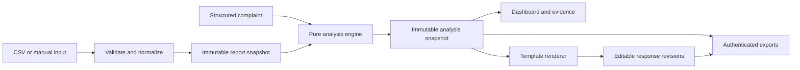

# Sightline — Product and Technical Specification

Date: 2026-09-07  
Status: Implementation handoff; product choices below are proposed defaults, not an assertion of the original app's internals.  
Companion: [Implementation plan](../plans/2026-09-07-sightline.md)  
Visual reference: a user-supplied dashboard screenshot, held privately. It is not distributed with this repository, because it is third-party material containing an identifiable person. Every intentional departure from it is described in section 4.2 and recorded in `docs/verification.md`.

## 1. Objective and evidence boundary

Build a working agency application that compares a client's complaint with search, website, and lead evidence, identifies the most plausible area to investigate, and drafts a respectful, editable response. Recreate the supplied dark dashboard's information hierarchy and styling, while replacing unsupported certainty with explainable findings.

The only evidence about the original application is the user-supplied screenshot and Reddit text. Its implementation, integrations, algorithm, commercial availability, and actual functionality are unknown. This document is an independent design, not reverse engineering of its source.

The requested deliverable is this specification and its implementation plan. No application implementation or deployment is part of the current documentation task.

### Design decisions

| Decision | Default for implementation | Reason |
|---|---|---|
| First release | Working, authenticated, upload-first agency app | Delivers useful analysis without waiting for Google OAuth and instrumentation |
| Data ingestion | Documented CSV templates and matching manual forms | Predictable semantics, traceability, reproducible results |
| Analysis | Versioned deterministic rules | Every finding can be explained and tested |
| Response generation | Deterministic templates in release 1 | No model key, unpredictable numbers, or provider cost required |
| AI expansion | Optional constrained narrative adapter after release 1 | Models may explain approved facts; they must not decide numerical truth |
| Deployment | One Node application and PostgreSQL; container-ready | Small operational surface, persistent data, local development parity |
| Accounts | Private agency workspaces; owner and analyst roles | Agencies must never see one another's clients |
| Branding | Retain “Sightline” in the agency UI | Recognizable recreation; neutral language in client-facing responses |

Alternatives considered: a screenshot-only prototype is quicker but cannot analyze real reports; Google integrations from launch reduce manual work but add OAuth, quotas, data reconciliation, and an instrumentation dependency before the workflow is validated. Upload-first is the recommended release sequence. These are assumptions the user can revise before implementation; neither companion document claims explicit approval of a technology vendor.

### Success criteria

An agency user can create a client, enter a complaint, import two comparable reporting periods, inspect a diagnosis with source references, edit/copy a response, and reopen the same historical analysis after restarting the application. The sample scenario resembles the supplied dashboard and all visible release-1 controls work. Missing or contradictory evidence never silently turns into a confident verdict.

## 2. Scope and delivery boundaries

### Release 1 — required

1. Authentication, tenant isolation, workspace provisioning, owner/analyst authorization.
2. Clients and client-specific reporting definitions.
3. Report wizard with downloadable CSV templates, manual entry, preview, validation, and immutable committed report snapshots.
4. Complaint capture with category, actual reporting period, and the client's original wording.
5. Deterministic comparison, evidence findings, complaint assessment, diagnosis, and next checks.
6. Dashboard, historical analysis selector, metric cards, sparklines, traffic chart, page/keyword tables, evidence details, and response editor.
7. Analysis history, complaint list, response templates, settings, and authenticated Markdown/CSV export.
8. Empty/error/loading/insufficient-data states, accessible responsive layouts, and a clearly labeled fictional demo.
9. Automated correctness, isolation, persistence, and browser workflow verification.

### After release 1 — separate deliverables

GA4 and Search Console read-only connectors; rank-tracker exports/adapters; web-form instrumentation or monitoring integrations; optional AI narrative; account invitations and self-service password recovery; scheduled refresh; CRM/call tracking; client portals; PDF reports; paid subscriptions; email sending.

Do not include these later features as enabled buttons or promise that report uploads magically supply them. Arbitrary PDF/image extraction, OCR, automatic website crawling, automatic repair, and attribution of fault to an individual are outside release 1. A single app can later support all these adapters without rewriting its normalization and analysis core.

## 3. Users, roles, and workflow

| Capability | Owner | Analyst |
|---|---|---|
| View workspace clients and historical analyses | Yes | Yes |
| Create/update clients; import reports; create complaints/analyses | Yes | Yes |
| Edit response drafts, copy, export | Yes | Yes |
| Edit workspace templates, retention setting, workspace display name | Yes | No |
| Archive clients, permanently delete a client and its data | Yes | No |
| Provision/deactivate users | Operator CLI in release 1 | No |

Release 1 has no public signup or invitations. An operator provisions an owner and workspace through a documented CLI that uses the auth library's supported account APIs. Additional users are provisioned through the same CLI. Users belong to exactly one workspace in release 1; enforce this in the database. Browser requests never choose their own workspace ID. No seeded password or demo account may be enabled in production.

### Primary journey

1. Sign in; choose or create a client. First use displays “Add a client” and “Explore demo.”
2. Select **New Analysis**. The wizard selects the client, captures complaint text/category and complaint period, and chooses a saved report or starts an import.
3. Specify current and baseline periods and reporting definitions. Default comparison: two consecutive, complete, non-overlapping 28-day windows ending yesterday in the client's time zone. Custom equal-length windows are allowed.
4. Import required organic-summary data and optional keywords, forms, landing pages, and trend data; or enter equivalent values manually. Inspect field-level errors and evidence gaps before committing.
5. Confirm a preview. A committed report is immutable. Corrections create a new report linked through `supersedesReportId`; analyses already using the old report retain their original evidence.
6. Create an analysis. The application computes metrics/rules and stores a complete versioned snapshot in one transaction. Missing optional inputs may yield a qualified result; missing critical inputs yield `insufficient_evidence` with concrete next steps.
7. Read the dashboard, expand evidence, and review the suggested response. Edit and save the draft, copy it, or download an analysis Markdown file. The app does not send messages.
8. Return through Analysis History; see the original report, rules version, and latest saved draft. Reanalyze creates a new analysis, never modifies an old result.

Complaints can be saved before reports exist, with status `open`. Status transitions are `open -> analyzed -> resolved`; the user explicitly marks resolved or reopens. Creating another analysis leaves the complaint analyzed. Archived clients remain readable and exportable, but cannot receive new imports/complaints/analyses until restored.

## 4. Screen and interaction specification

### 4.1 Routes

| Route | Contents and actions |
|---|---|
| `/login` | Email/password sign-in, generic failure, sign-out supported elsewhere |
| `/dashboard` | Client selector; latest analysis or onboarding; redirects to a concrete analysis when available |
| `/analyses/new?clientId=...` | Complaint/report wizard; resumable only after explicit save of complaint or import draft |
| `/analyses/[analysisId]` | Full dashboard for an immutable analysis, with editable response revision |
| `/reports/new?clientId=...` | Standalone report import wizard |
| `/reports/[reportId]` | Committed report summary, provenance, imported tables, create corrected report |
| `/complaints` | Client/status/category filters; create, view original text, resolve/reopen, start analysis |
| `/history` | Client/date/diagnosis filters, paginated results, open analysis, reanalyze |
| `/clients` and `/clients/[clientId]` | Client CRUD, archive/restore, owner-only deletion, definitions, reports and complaints |
| `/templates` | Owner editing, analyst read-only preview; reset to bundled template |
| `/settings` | Workspace name, profile readout, role, owner retention controls, sign out |
| `/demo` | Public, fixed, fictional read-only dashboard; no production data or mutations |

All app routes except `/login` and `/demo` require a valid server-verified session. `/demo` uses the same presentational components and pure analysis engine, with in-memory bundled fixtures. “Try an analysis” there leads to sign-in; copy remains local and edits are clearly unsaved demo edits.

### 4.2 Visual reconstruction

Reference canvas: 1536 × 1024. At that size, sidebar approximately 288 px; main padding 22–28 px; two dashboard columns approximately 60:40 with a 16–20 px gap. Preserve the screenshot's dense but readable layout:

- Nearly black/navy background `#050A13`; sidebar `#080D17`; cards `#0B111D`; subtle borders `#1D2534`.
- Main text `#F4F5F8`, secondary text `#B7BBC6`; purple action/accent `#5940E8`; green `#38C761`; amber `#FFAD14`; red `#FF5149`; blue chart line `#4B6BFF`. These are proposed tokens, not sampled exact originals. Verify contrast and adjust when necessary.
- System sans-serif stack; 28–32 px page heading, 18–20 px panel headings, 14–16 px body, 28–32 px metric values. Corners 10–12 px, 1 px borders, restrained shadows.
- Sidebar: original text mark with a new magnifier/chart icon, purple selected item, nav icons, optional small detective illustration panel, signed-in user's name/role at bottom. Use a simple new SVG/CSS illustration; do not reproduce the screenshot's named person or portrait.
- Header: Dashboard title, subtitle “SEO performance and lead-generation evidence,” client selector, report/analysis selector showing both periods, purple **New Analysis** button.
- Main left column: conclusion card, four metrics, traffic chart, two compact tables.
- Right column: complaint card with burgundy tint; diagnosis/evidence card; suggested response card.
- Footer: actual source freshness and report period, not a hardcoded global date.

At widths ≥1280 px use the full sidebar and two content columns. From 1024–1279 use a 76 px icon rail with accessible labels and slightly narrower columns. Below 1024 stack content and replace sidebar with a menu drawer. Metric grid is four columns at ≥1280, two at 480–1279, one below 480. Below 768, use natural document scrolling, touch-sized controls, and horizontally scrollable tables within their cards. At 390 px, only table containers may overflow horizontally.

### 4.3 Dashboard requirements

| Screenshot element | Implemented behavior |
|---|---|
| Overall Excuse Validity | **Complaint assessment** card with observed-outcome status and likely investigation area |
| “82% not valid” gauge | Segmented, nonnumeric **Investigation focus** indicator: measurement, search acquisition, post-click, mixed/unclear. Text labels and evidence strength beside it; no probability or validity percentage |
| Traffic card | Organic sessions change, raw totals, exact dates/scope, optional actual trend |
| Keywords top 10 | Net change within the same tracked commercial keyword cohort; includes entered/exited counts when rows exist |
| Conversion rate | Organic lead-session rate, relative percent change, raw rate values and percentage-point difference in detail |
| Form errors | Error count multiple plus failures/attempts rate when available; scope visible |
| Traffic overview | Actual period or daily data, users and sessions toggles, date range, tooltips; missing intervals are gaps |
| Top pages | Sort by current organic landing-page sessions descending; top five; full report opens complete paginated table |
| Keyword movement | Matched cohort with previous/current position and signed improvement; top five improvements; full table available |
| Complaint | Original quoted text, category, received date, complaint period |
| Diagnosis | Ordered findings, evidence source buttons, caveats, recommended next checks and responsible function to involve |
| Suggested response | Editable plain text, save with revision conflict handling, regenerate with overwrite warning, copy with feedback |

Conclusion text must use “Evidence points to…” or “Investigate…” rather than “The client is wrong” or “SEO is definitely working.” Agency humor belongs in branding only. In release 1 label the right-hand panel **Evidence diagnosis**, not “AI Diagnosis,” because it is rule generated.

Never draw fake sparklines from two summary values. If trend data is absent, omit the sparkline and show “Trend data not provided.” One optional trend block does not imply trend availability for every metric. Metric detail drawers show numerator/denominator, formula, source type, source label, retrieval date, coverage, and why the metric can or cannot inform this complaint.

The traffic chart defaults to the last six supplied complete period buckets. Selector options: current period, last three supplied periods, last six supplied periods; disable unavailable choices. Daily input can show the current period. Never sum daily unique active users into a monthly user total. Each displayed unique-user point must come from an independently supplied aggregate for that exact bucket. Charts have an equivalent data table and visible legends; color is never the sole signal.

### 4.4 State and accessibility requirements

- Initial, loading, no client, no report, no complaint, incomplete report, import validation failed, save failed, stale source, insufficient evidence, empty table, unauthorized, expired session, and not-found states have specific text and recovery actions.
- A zero is displayed as `0`; missing is `Not provided`; invalid comparisons are `Not comparable`. No zero-filling.
- Keyboard navigation covers drawer/dialog focus management, wizard steps, selectors, table sorting, and response editing. Visible focus rings, semantic headings, named inputs, 44 px primary touch targets, reduced-motion support, and WCAG AA contrast are release requirements.
- Response save failures retain the user's unsaved text; copy copies the text visible in the editor and announces success/failure. If clipboard permission fails, select the text and show a manual-copy instruction.

## 5. Data acquisition and metric semantics

### 5.1 Where the evidence comes from

| Evidence | Release-1 input | Later direct source | Limitation |
|---|---|---|---|
| Organic sessions, active users, lead-session rate | Organic-summary template/manual form | GA4 Data API | Channel and conversion event definitions must match between periods |
| Query visibility | Keyword template with `sourceKind=gsc` | Search Console API | Average observed position; incomplete query universe; not fixed keyword rank |
| Tracked keyword positions | Keyword template with `sourceKind=rank_tracker` | Rank tracker API | Requires identical keyword/device/location/search-engine cohort |
| Form failures and attempts | Forms template/manual instrumentation totals | Form backend/monitoring tool | Not automatically supplied by traffic/ranking reports |
| Leads received / qualified leads / revenue | Optional outcome fields with source note | CRM, call tracking, payment systems | Must distinguish attribution, recording dates, and deduplication |
| Tracking integrity | Operator evidence note and status | Monitoring/reconciliation adapters | An assertion of verification is recorded with who/when/evidence, not treated as omniscience |

GA4 distinguishes session key-event rates, including event-specific rates; an “any key event” rate may include events unrelated to leads. The future connector must discover and select the configured lead event. [Google Analytics metric schema](https://developers.google.com/analytics/devguides/reporting/data/v1/api-schema)

Google's enhanced measurement documents `form_start` and `form_submit`; the design requires a separate explicit source for submission failure or delivery failure evidence. Merely seeing a submit event is not confirmation that a lead arrived in the client's CRM or inbox. [Enhanced measurement events](https://support.google.com/analytics/answer/9216061?hl=en-IE)

Search Console returns average position and does not guarantee all query rows. Use “Observed queries averaging top 10” for GSC-derived counts, display coverage caveats, and exclude that count from the release-1 fixed-cohort rank signal. [Search Analytics API](https://developers.google.com/webmaster-tools/v1/searchanalytics/query)

### 5.2 Shared report metadata

Every report contains `clientId`, `reportLabel`, `currentStart`, `currentEnd`, `baselineStart`, `baselineEnd`, `timeZone` (IANA), `channel` (`organic_search`), `propertyLabel`, `leadDefinition`, `leadEventName`, `trackingStatus` (`verified`, `unverified`, `known_issue`), `trackingEvidenceNote`, `trackingReviewedAt`, `trackingReviewedBy`, and one source metadata object per imported dataset.

Each dataset source object contains `sourceKind` (`ga4_export`, `gsc`, `rank_tracker`, `form_backend`, `crm`, `manual`), `sourceLabel`, `exportedAt`, `coverage` (`complete`, `partial`, `unknown`), `scopeKey`, and `definitionVersion`. A manual entry requires a meaningful source/evidence note. `scopeKey` encodes property, channel, country/device filters and, for form data, form ID. Operators can acknowledge a cross-source time-zone difference; acknowledgment exposes a caveat and never relabels the original time zone.

All dates are ISO local dates inclusive of both ends; timestamps are UTC instants. Both windows must contain 7–93 days, have equal length, end before the current local day, and not overlap. Default uses 28 days; custom year-over-year is allowed if day counts match, with a seasonality/weekday caveat. Current window must start after baseline ends. The report's organic source timezone must match the selected report timezone. Dataset-specific timezones are retained for optional external evidence.

Changing client definitions affects new reports only. Snapshot all definitions in existing reports/analyses. Detect comparison mismatches before deriving any trend. Analytics exports with rounding only, ambiguous event counts, missing channel filters, or incompatible definitions must not be silently interpreted as the canonical lead-session metric.

### 5.3 Canonical CSV templates

Release 1 accepts these templates, not arbitrary provider exports. Each template is downloadable with column descriptions and sample rows. The wizard sets common metadata; files only contain the tabular rows described here. Offer an explicit mapping UI only in a later release. Manual entry uses the exact same schema and validation path.

| Dataset | Required header, in any column order | Rules |
|---|---|---|
| Organic summary, required | `period,sessions,active_users,lead_sessions` | Exactly two rows: `baseline`, `current`; sessions required integer ≥0; other counts nullable; lead sessions ≤ sessions |
| Keywords, optional | `period,keyword,device,location,search_engine,position,intent,tracked` | Two observations per tracked cohort member; integer rank ≥1 or blank = explicitly unranked; `intent=commercial|informational|unknown`; `tracked=true|false` |
| Forms, optional | `period,form_id,scope,attempts,failed_attempts,error_events` | Counts nullable except error_events; failures ≤ attempts; scope `organic_search|all_channels`; match form ID and scope across periods |
| Landing pages, optional | `period,path,sessions` | Path begins `/`, no query strings or fragments; unique per period; nonnegative integers; these are landing-page sessions, not page views |
| Traffic trend, optional | `start_date,end_date,sessions,active_users` | Each row is a supplied aggregate; no overlapping buckets; sessions required, users nullable; `trendGranularity=day|period` in metadata |

For required CSV headers, blank nullable values mean unknown; absent required headers reject the file. Organic-summary source metadata must describe both periods' coverage and definitions individually so mismatches are detectable. For each optional dataset, the wizard provides baseline/current source metadata too.

For keywords, normalize whitespace and Unicode case folding for the comparison key while retaining display text. The key is `(keyword, device, location, search_engine)`. A member is eligible only if it appears in both periods, both rows are `tracked=true`, both intent values are `commercial`, and intent/device/location/search-engine definitions agree. A blank position on an existing row means confirmed unranked; a missing row means unknown and is excluded. Mixed rank-tracker/GSC sources never share a cohort. Reject duplicate keys within a period. Do not infer commercial intent from the mere presence of a keyword.

For form analysis, use the single selected form and scope saved in the report. Multiple forms may be imported for inspection, but do not pool their rates or double-count retries. `attempts` and `failed_attempts` are unique logical attempts from the same instrumentation; `error_events` can repeat and is a separate count. The UI requires this definition acknowledgment.

Optional business outcomes are entered in a structured manual form with `metric=received_leads|qualified_leads|revenue`, baseline/current value, `scope=organic_search|all_channels`, currency for revenue, source label, definition version, coverage, and attribution note. Release 1 stores these in the snapshot without a separate outcomes CSV. Zero is allowed and meaningful. Lead counts are nonnegative safe integers; qualified leads cannot exceed received leads in the same population/period. Revenue is nonnegative, in currency minor units; refunds/net-negative revenue require a separate later definition. Cross-channel outcomes cannot contradict an organic-only complaint unless that complaint explicitly concerns all channels.

### Import limits and lifecycle

- UTF-8 CSV, optional BOM, commas, quoted fields/newlines supported. Reject invalid encoding, duplicate headers, unknown headers, malformed quoting, non-finite numbers, localized numeric separators, and executable/spreadsheet formulas in data cells. Plain text fields remain escaped on display and formula-prefixed cells must be neutralized on export too.
- Maximum 5 MiB per file, 20,000 rows per file, 25 MiB and 50,000 rows per report, 2,000 characters per text cell, 5,000 per complaint, 10,000 per draft. Enforce raw-byte limit before buffering the full upload; stop parsing at row/cell limits. Do not evaluate file contents.
- Draft states: `draft -> validated -> committed`, or `draft/validated -> deleted`. Edits invalidate validation and increment revision. Validation records the draft content hash. Commit requires the same revision/hash and occurs atomically; a concurrent edit returns 409.
- Import preview returns row numbers, field names, rejected values, and readable messages, up to 100 errors plus total error count. Failed import never creates a committed report.
- Store normalized rows as versioned JSONB plus minimal source metadata and SHA-256 hashes of original files; discard raw uploaded bytes after parsing. A download of normalized data is not advertised as the original file. Retain file names only after sanitizing; do not log file content.
- Expire abandoned drafts after seven days. Committed reports are immutable; exact repeated commits with the same request key return the original result. A repeated file hash warns but does not forbid a user from explicitly importing it again.
- If a traffic-trend bucket exactly matches a summary window, its sessions and any known active-user totals must agree with the summary. Reject conflicting totals with references to both inputs. Do not compare an aggregate unique-user total to a sum of daily unique users.

## 6. Calculation contract

Use unrounded decimal arithmetic for decisions. JavaScript finite numbers suffice for counts within safe integer bounds and ratio calculations; persist calculated values as JSON numbers with an explicit unit. Round only in formatting, using half-away-from-zero for display. Do not average rates across rows. Sum eligible numerators and denominators only when their populations are disjoint and definitions match; release 1 compares one canonical organic-summary pair and one selected form pair, avoiding ambiguous pooling.

| Metric | Formula / behavior |
|---|---|
| Relative change | `100 * (current - baseline) / baseline`; baseline 0/current >0 => `new`, no numeric percent; both 0 => `no_activity`, no numeric percent; baseline >0/current 0 => -100% |
| Absolute change | `current - baseline`; always label unit |
| Lead-session rate | `lead_sessions / sessions`; sessions 0 => unavailable, even if leads also 0 |
| Rate relative change | Relative change of the two unrounded rates |
| Percentage-point change | `100 * (currentRate - baselineRate)` |
| Error multiple | `current.error_events / baseline.error_events`; baseline 0 => unavailable/new, never infinity |
| Form failure rate | `failed_attempts / attempts`; attempts 0 => unavailable |
| Top-10 count | Eligible tracked commercial cohort rows where position is 1–10 inclusive |
| Net top-10 change | Current top-10 count minus baseline count; never call it “new keywords” |
| Entered/exited top 10 | Eligible members crossing into/out of 1–10; net = entered minus exited |
| Rank movement | `baseline.position - current.position`; positive means improved; transitions to/from unranked use text labels, not fake rank 100 |

Main metric deltas display whole percentages; rates display one decimal place on cards and up to three in detail; percentage points two decimals; count multiples one decimal unless exact integer. Always preserve values and formulas in exported evidence. Units must distinguish `%` from `pp` and `x`.

Do not multiply rounded rates by traffic and call the result observed leads. `lead_sessions` is sessions containing the configured lead action; it is neither event count nor deduplicated received leads. The screenshot's 12,540 × 1.2% and 7,210 × 2.1% imply approximately 150 and 151 such sessions. This is an interpretation of the example, not evidence that either period delivered that many real leads.

## 7. Analysis engine, outcomes, and guardrails

### 7.1 Three separate outputs

1. `complaintAssessment`: whether the measurable outcome claimed is supported, contradicted, or unverified.
2. `diagnosis`: which area the available evidence says to investigate.
3. `evidenceStrength`: `limited` or `moderate`, with explicit eligibility/gap reasons. Release 1 does not produce “high confidence,” percentages, or causal certainty.

The complaint's wording is preserved, but the user selects a structured category and scope. Categories: `no_leads`, `leads_down`, `traffic_down`, `rankings_down`, `revenue_down`, `lead_quality`, `seo_underperforming`, `other`. Complaint scope is `organic_search|all_channels` and its date window must match the current reporting period for an outcome assessment; otherwise assessment stays unverified with an alignment warning. The diagnosis can still describe the report periods if clearly labeled separately.

### 7.2 Data quality and usable signals

Global measurement issue takes precedence when tracking status is `known_issue` or required organic definitions are incompatible. Structurally invalid data cannot be committed. Missing data is not a tracking issue by itself.

Base acquisition signal requires complete organic-summary coverage in both periods, matching scope/timezone/definitions, and ≥100 sessions in each period. Traffic direction is up at ≥+10%, down at ≤−10%, otherwise flat.

Conversion signal additionally requires known lead-session counts and ≥20 baseline lead sessions. Current zero is eligible when current sessions ≥100 and tracking has no known issue; do not suppress a complete conversion collapse through a minimum-current-leads threshold. Conversion rate is down at ≤−20% relative change, up at ≥+20%, otherwise flat. These thresholds are product heuristics, not statistical significance tests.

Fixed-cohort rank signal requires a rank-tracker source, complete comparable coverage, and ≥20 eligible commercial keyword members. Top-10 direction is down when net change ≤−5, up at ≥+5, otherwise flat. GSC rows can supply descriptive context but cannot activate this rule. An eligible rank decline can signal an acquisition concern even while total traffic rises, because traffic volume alone does not establish traffic quality.

Form signal requires comparable complete evidence for the selected form, ≥100 attempts in each period, and known failed-attempt counts. It is degraded when failure rate rises by both ≥2 percentage points and ≥50% relative. If baseline failure rate is zero, use ≥2 pp and ≥5 current failed attempts. Raw error-event counts without attempts are context only. Form evidence from all channels or a different time zone is explicitly indirect corroboration and cannot, by itself, activate a post-click diagnosis for organic complaints.

`postClickConcern = conversionDown OR eligibleOrganicFormDegradation`.

`acquisitionConcern = trafficDown OR eligibleRankDown`.

Unverified tracking allows qualified diagnoses but caps evidence strength at limited. Source coverage partial/unknown makes that source ineligible for the directional rule, while its raw values remain visible with a caveat. Store quality flags per dataset and per signal; never mask one dataset's missing denominator with another source's number.

### 7.3 Deterministic diagnosis decision table

Evaluate in this exact order:

| Priority | Condition | `diagnosis` | Headline |
|---|---|---|---|
| 1 | Known tracking issue or incompatible required definitions | `measurement_issue` | Resolve measurement problems before attributing the change |
| 2 | Base acquisition signal unavailable | `insufficient_evidence` | More comparable evidence is needed |
| 3 | Acquisition concern AND post-click concern | `mixed` | Search acquisition and post-click performance both need investigation |
| 4 | Acquisition concern | `search_acquisition` | Investigate search visibility and traffic quality |
| 5 | Post-click concern | `post_click` | Evidence points to a post-click investigation |
| 6 | Otherwise | `no_clear_issue` | No clear issue is established by the supplied report |

`no_clear_issue` never means the client's experience is false. Rising sessions and stable ranks without conversion/delivery evidence must include “Lead delivery and business outcomes have not been verified.” Lost lead quality, revenue, device/country mix, seasonality, content intent, and algorithm changes may remain unexplained.

### 7.4 Outcome assessment

Use direct evidence matching category, complaint scope, period, and definition. Complete outcome source coverage is required; zero must be explicitly supplied.

| Category | Direct evidence | Assessment rule |
|---|---|---|
| `no_leads` | Current received leads | 0 => supported; >0 => contradicted; otherwise unverified |
| `leads_down` | Baseline/current received leads | Current < baseline => supported; current ≥ baseline => contradicted; otherwise unverified |
| `traffic_down` | Comparable organic sessions | Same exact-count comparison; all-channel complaint is unverified without all-channel data |
| `rankings_down` | Eligible fixed cohort top-10 net | Net <0 => supported within that cohort; net ≥0 => contradicted within that cohort; otherwise unverified |
| `revenue_down` | Comparable revenue, same currency/attribution | Current < baseline => supported; otherwise contradicted; missing => unverified |
| `lead_quality` | Defined qualified/received lead rate, denominator >0 in both periods | Lower => supported; otherwise contradicted; missing definitions/counts => unverified |
| `seo_underperforming`, `other` | No specific measurable claim | Always unverified; report diagnostic findings separately |

Known measurement issues invalidate assessments relying on the affected source. They do not erase independent CRM evidence; a CRM-confirmed zero-lead outcome may be supported while attribution remains `measurement_issue`. Outcome comparisons are literal, while diagnosis thresholds filter small movements; explain this distinction if a small decline supports an outcome but produces `no_clear_issue`.

### 7.5 Evidence strength, findings, and recommendations

Strength is moderate only when tracking is verified, base acquisition is eligible, and an independent eligible source corroborates the selected diagnosis: a deteriorating rank-tracker cohort for `search_acquisition`, a degraded organic form-backend failure rate for `post_click`, or either of those for `mixed`. For `mixed`, both concerns must also be eligible. For `no_clear_issue`, `measurement_issue`, and `insufficient_evidence`, use limited. GA4 traffic and GA4 conversion changes alone are one source and therefore limited. Indirect all-channel form observations cannot raise strength. Independence is based on the underlying collection system recorded in source metadata, not the number of files or a user-renamed source label; `manual` values cannot raise strength without an identified independent underlying source and verification note.

Each finding stores a stable ID, rule ID, statement key, rendered text, direction, unrounded values, unit, source row references, eligibility state, and caveat list. Recommendations reference finding IDs and use functions to involve (`SEO`, `web development`, `analytics`, `sales operations`), not accusations of who caused the problem.

Suggested next checks by diagnosis:

- Measurement: confirm event configuration and consent/tagging changes; compare analytics with form/backend or CRM records.
- Search acquisition: examine query intent and branded/nonbranded, device, country, landing page and commercial-cohort changes; check indexing and demand.
- Post-click: reproduce the form journey, verify backend acceptance and email/CRM delivery, inspect device/browser breakdown and landing-page fit. No automatic test submissions in release 1.
- Mixed: investigate both chains and sequence measurement verification before fixes.
- No clear issue/insufficient: collect named missing evidence; do not prescribe an unsupported technical repair.

These lists are deterministic templates selected by rule IDs. Never infer a particular broken plugin, HTTP status, CRM error, or deployment from aggregate data.

## 8. Response drafting and export

Release 1 renders a template from approved findings. All templates are plain text with a restricted token allowlist: `client_name`, `agency_name`, `current_period`, `baseline_period`, `complaint_summary`, `evidence_summary`, `caveats`, `next_steps`, `sender_name`. Unsupported tokens reject template save; there is no arbitrary code or HTML evaluation.

Owner-editable template text has a 10,000-character cap. Computed evidence paragraphs and caveats are mandatory appendices outside the editable template, so deleting a token cannot hide essential limitations from the initial generated draft. The user can edit the final draft; label it “Agency-edited draft” after edits, retain the original generated text, and do not claim edited statements were engine-verified.

Example default draft for the demo:

> Hi [Client name],
>
> Thanks for flagging the lack of leads. The report shows organic sessions increased from 7,210 to 12,540, while the tracked lead-session rate fell from about 2.1% to 1.2%. The tracked commercial keyword cohort also has 31 more keywords in the top 10, and the selected form's failure rate increased.
>
> This points to a post-click issue worth investigating, but it does not establish why leads have not reached you. We have not reconciled these tracked actions with your inbox or CRM, and increased traffic alone does not prove improved traffic quality.
>
> I suggest checking the form journey and lead delivery, then reviewing the incoming traffic's relevance. We can use those checks to agree on the right next steps together.
>
> Best regards,
> [Sender name]

Store generated text, edited text, monotonically increasing revision, editor ID and timestamps. Save requires expected revision; a 409 conflict returns the latest revision and retains the local draft for manual reconciliation. Regenerate asks for confirmation if unsaved edits exist and creates a new revision. Copy does not silently save. No email or messaging integration in release 1.

Markdown export includes complaint, dates/scope, assessment, diagnosis, evidence strength, complete metric evidence table, findings, gaps, next checks, current saved response with edited/generated label, source metadata, report/analysis IDs, and rule version. CSV exports of pages/keywords neutralize formula-like cell prefixes and escape quoting/newlines. All export routes require the same tenant checks as screen reads; no public share URLs.

## 9. Architecture and persistence

### 9.1 Proposed stack

- Next.js App Router with TypeScript, React, Tailwind CSS, accessible Radix-based controls, Lucide icons, Recharts, and Zod validation.
- PostgreSQL with Drizzle ORM and checked-in SQL migrations; Node runtime rather than Edge for database/import handlers.
- Better Auth for email/password credentials and server sessions; disable public sign-up, use library-provided password/session handling.
- Vitest for domain/parser tests; PostgreSQL integration tests; Playwright and axe for browser flows/accessibility.
- npm lockfile, supported Node LTS compatible with selected dependencies, Docker Compose for local PostgreSQL. Resolve current stable compatible versions at implementation start, record them, and pin through the lockfile. This spec does not claim an unverified version combination.

Official implementation references: [Next.js installation](https://nextjs.org/docs/app/getting-started/installation), [Better Auth options](https://better-auth.com/docs/reference/options), [Drizzle PostgreSQL](https://orm.drizzle.team/docs/get-started-postgresql), [Drizzle transactions](https://orm.drizzle.team/docs/transactions). Follow these for framework-specific APIs; business contracts below are application design decisions.

### 9.2 Boundaries and flow



The pure domain package has no database, framework, network, environment-variable, or language-model dependencies. UI components consume typed view models; calculations do not live inside chart components. Server repositories handle authorization and persistence. No background queue is needed for bounded release-1 parsing and deterministic analysis; do not introduce a worker service until a connector or model genuinely requires it.

### 9.3 Persistent entities

| Entity | Required fields and invariants |
|---|---|
| Auth tables | Library-generated user, session, account, verification tables; passwords handled only by library |
| `workspaces` | UUID, name, retentionDays (`null` or 90/180/365), revision, timestamps |
| `memberships` | userId unique, workspaceId, role, active; one workspace per user |
| `clients` | UUID, workspaceId, name, normalized domain, timezone, definitions JSONB, archivedAt, revision, timestamps |
| `complaints` | UUID, workspaceId, clientId, originalText, category, scope, period dates, receivedAt, status, revision, creator |
| `import_drafts` | UUID, workspaceId, clientId, normalized payload JSONB, revision, hash, validation JSONB, state, expiresAt |
| `reports` | UUID, workspaceId, clientId, schemaVersion, source snapshot JSONB, normalized datasets JSONB, supersedesReportId nullable, contentHash, createdAt, creator |
| `analyses` | UUID, workspaceId, clientId, reportId, complaintId, parentAnalysisId nullable, complaint snapshot JSONB, ruleVersion, resultSchemaVersion, result JSONB, requestKey, createdAt, creator |
| `response_templates` | UUID, workspaceId, name, body, revision, creator/editor, timestamps |
| `response_revisions` | UUID, workspaceId, analysisId, revision, template snapshot, generatedText, editedText nullable, creator/editor, createdAt |
| `audit_events` | UUID, workspaceId, actorId, action, entityType, entityId, timestamp; no complaint/report bodies or credentials |
| `idempotency_records` | workspaceId, operation, requestKey, requestHash, resultId, createdAt; unique composite key |

Use `(workspaceId,id)` unique constraints on tenant entities and composite foreign keys for every tenant-owned relationship; include clientId in report/complaint relationship validation so an analysis cannot combine two clients in one workspace. Index workspace/client/createdAt history queries. Also check scope in repository methods; constraints are a second layer. Historical predecessor links are nullable and use appropriate `SET NULL` behavior on deletion without nulling workspace/client ownership columns; use a separate nullable link table if the chosen migration tooling cannot express that safely.

Committed snapshots carry schema versions, and existing analyses render their saved result without re-running current rules. Edits to complaint metadata do not rewrite analysis snapshots. Report corrections and reanalysis link to predecessors. Deletion is an explicit separate operation, not in-place rewriting of history.

### 9.4 Canonical domain interfaces

```ts
type Period = 'baseline' | 'current';
type Diagnosis = 'measurement_issue' | 'insufficient_evidence' | 'mixed'
  | 'search_acquisition' | 'post_click' | 'no_clear_issue';
type Assessment = 'supported' | 'contradicted' | 'unverified';
type Change =
  | { kind: 'relative'; percent: number; absolute: number }
  | { kind: 'new'; absolute: number }
  | { kind: 'no_activity'; absolute: 0 }
  | { kind: 'unavailable'; reason: string };

type OrganicRow = {
  period: Period;
  sessions: number;
  activeUsers: number | null;
  leadSessions: number | null;
};

type EvidenceRef = { dataset: string; period: Period | null; rowKey: string };
type Finding = {
  id: string; ruleId: string; statementKey: string; text: string;
  direction: 'up' | 'down' | 'flat' | 'unknown';
  values: Record<string, number | null>; unit: string;
  sources: EvidenceRef[]; eligible: boolean; caveats: string[];
};

type AnalysisResult = {
  schemaVersion: 1; ruleVersion: '1.0.0';
  diagnosis: Diagnosis; complaintAssessment: Assessment;
  assessmentReason: string; evidenceStrength: 'limited' | 'moderate';
  strengthReasons: string[]; findings: Finding[]; gaps: string[];
  nextChecks: { text: string; functionToInvolve: string; findingIds: string[] }[];
};
```

Zod is the runtime source of truth for full report/complaint schemas; infer TypeScript types from it. The implementation fills those schemas using the exact fields in sections 5 and 9, rather than creating a second incompatible naming scheme. Use camelCase internally and snake_case only at CSV boundaries.

### 9.5 HTTP contracts

JSON success envelope `{ data, requestId }`; failures `{ error: { code, message, fields? }, requestId }`. Never include stack traces. Session is derived server-side. IDs are UUID strings. Lists use keyset pagination on `(createdAt,id)`, default 25 and max 100, returning `nextCursor` or null.

| Endpoint | Request / result |
|---|---|
| `/api/auth/[...all]` | Auth library route; supported sign-in/out/session only; public signup disabled |
| `GET/POST /api/clients` | List/create client; creation returns 201 and persisted client |
| `GET/PATCH/DELETE /api/clients/:id` | Read/update with `expectedRevision`; owner-only hard delete with typed client-name confirmation; archive/restore via PATCH |
| `GET/POST /api/complaints` | Filtered list/create; client ID/category/scope/dates/text required |
| `GET/PATCH /api/complaints/:id` | Read/edit/status transition with expected revision |
| `POST /api/imports` | Create draft with client and metadata; returns ID/revision |
| `GET/PATCH/DELETE /api/imports/:id` | Read/save manual data or metadata/delete draft; expected revision on writes |
| `POST /api/imports/:id/files` | Multipart `dataset`, `file`, `expectedRevision`; bounded parse and normalized preview |
| `POST /api/imports/:id/validate` | expected revision; complete validation report and validated content hash |
| `POST /api/imports/:id/commit` | revision/hash plus `Idempotency-Key`; creates report atomically; replay returns same report |
| `GET /api/reports` and `/api/reports/:id` | Client-filtered list and full immutable report |
| `POST /api/analyses` | reportId, complaintId, optional parentAnalysisId and `Idempotency-Key`; creates result and first response revision atomically |
| `GET /api/analyses` and `/api/analyses/:id` | History filters and snapshot plus latest response |
| `PATCH /api/analyses/:id/response` | expected revision and edited text; creates next revision |
| `POST /api/analyses/:id/response/regenerate` | expected revision and templateId; creates next generated revision |
| `GET /api/analyses/:id/export?format=md` | Authenticated attachment |
| `GET /api/reports/:id/export?dataset=keywords|pages` | Formula-safe CSV attachment |
| `GET/POST /api/templates` and `PATCH /api/templates/:id` | Workspace-scoped template list/create/update with expected revision; owner mutation only |
| `GET/PATCH /api/settings` | Workspace settings; expected revision; owner mutation only |
| `GET /api/health/live` and `/api/health/ready` | Minimal liveness; readiness verifies database access without disclosing internals |

Creation defaults to 201; reads/updates 200; deletes 204. Idempotent replay returns 200 with `replayed=true`. Same key/different request hash => 409. Scope mismatch/not found => 404; no session => 401; known resource but insufficient role => 403; stale revision => 409; validation => 422; oversized body => 413; rate limit => 429; transient database failure => 503. Protect all mutations with same-origin checks/CSRF protections appropriate to session cookies; GET does not mutate.

## 10. Security, privacy, and operations

- Never accept a workspace ID as authority; derive it from an active server membership for every request, export, and server-rendered read. Deactivation invalidates effective access even if a session cookie remains valid.
- HTTPS in production; secure HTTP-only same-site cookies; server-only secrets; library rate limiting for sign-in plus a documented proxy limit of 10 sign-in attempts/minute/IP. Do not implement custom password cryptography.
- Domain input is validated and stored, never fetched automatically; release 1 therefore requires no arbitrary-URL fetch capability. Escape all complaint/template/source strings. Reports and complaint text are data, never instructions.
- Import and export size limits apply server-side. Redact emails, tokens, report bodies, source rows, and draft text from logs. Use request IDs, error codes, timings, and row counts for diagnostics.
- Default retention is indefinite until owner deletion. Optional 90/180/365-day retention deletes analyses and their response revisions older than the cutoff, then reports older than the cutoff only if no retained analysis references them. Keep complaints/clients until explicit deletion; explain this in settings. Prune idempotency rows when their result is deleted. Purge expired drafts separately.
- Owner deletion requires typed client-name confirmation and deletes that client's complaints, drafts, reports, analyses and drafts/revisions in one transaction. Retain only an opaque deletion audit event with no client name/domain/content. Exports already downloaded cannot be revoked. No public deletion API without authentication.
- Provide a maintenance CLI invoked daily by the host scheduler, with a dry-run mode listing counts. Backups have an operator-managed retention default of 30 days, documented in the deployment runbook; restored systems must rerun retention/deletion procedures before serving users. Do not imply database deletion instantly purges backups.
- Deployment requirements: `DATABASE_URL`, auth base URL/secret, allowed origin; no model/API key needed for release 1. Bootstrap/provision secrets are CLI-only and not client-exposed. Demo fixtures must contain fictional identities/domains (`example.com`).
- Performance targets, measured on documented local/CI hardware: pure analysis under 250 ms for maximum normalized report; import validation under 5 s for maximum allowed input; normal dashboard server response under 1 s on warmed local app/database. Treat these as acceptance targets, not benchmark claims. Avoid returning all raw rows for history/list views.
- Display source export timestamps independently. If the selected current-period end is more than 45 calendar days before today, show “Historical report” with its dates; this is a freshness cue, not a reason to invalidate a complete historical comparison. Never label data “live” in release 1.

## 11. Demo dataset and expected results

Use a fictional client “Northstar Services” on `example.com`, agency “Demo Agency,” reporting timezone `America/New_York`, source export time `2026-08-11T12:00:00Z`. Baseline 2026-06-12 through 2026-07-11; current 2026-07-12 through 2026-08-10; 30 complete days each. Complaint received August 11 and refers to the exact current window: “SEO isn't working. We haven't gotten any leads.” Category `no_leads`, scope `organic_search`.

```csv
period,sessions,active_users,lead_sessions
baseline,7210,5800,151
current,12540,10150,150
```

```csv
period,form_id,scope,attempts,failed_attempts,error_events
baseline,contact,organic_search,200,5,5
current,contact,organic_search,220,15,15
```

Create 100 matched, tracked, commercial rank-tracker keyword members using deterministic fictional names, same desktop/US/Google scope. Members 1–54 rank 5 in both periods; members 55–85 move 18 -> 6; members 86–100 stay 22. Expected baseline top 10 =54, current=85, entered=31, exited=0, net=+31. A separate test fixture adds exits to prove net change is not universally the number entering.

Landing page current/baseline sessions: `/seo-services` 2340/1250; `/digital-marketing` 1890/1174; `/content-writing` 1245/814. These are a labeled subset, not a full reconciliation of site traffic. Optional six non-overlapping 30-day trend buckets ending 2026-03-13, 04-12, 05-12, 06-11, 07-11, 08-10 have sessions `[3500,5200,7000,9000,7210,12540]`, active users `[2800,4100,5600,7300,5800,10150]`. Compute each start date as end minus 29 calendar days. Do not copy the reference chart's inconsistent dates or synthesize the last two totals from unrelated points.

All relevant source coverage is complete; tracking is verified with fictional demo evidence clearly marked. No received-lead/CRM data is supplied.

Expected output:

- Traffic approximately +73.925%, displayed **+74%**.
- Lead-session rates approximately 2.094% -> 1.196%, displayed **2.1% -> 1.2%**; relative decline about 42.885%, displayed **−43%**. The screenshot's −42% does not follow from these exact counts and is deliberately not hardcoded.
- Lead sessions 151 -> 150, not zero confirmed leads.
- Form error events **3x**; unique failure rate 2.5% -> 6.818%, approximately +4.32 pp and +172.7% relative.
- Diagnosis `post_click`; strength `moderate` because independent, comparable form-backend evidence corroborates conversion deterioration with verified tracking.
- Complaint assessment `unverified` because received leads are not supplied.
- No numeric validity/confidence score; draft recommends form and delivery verification and traffic-quality review.

## 12. Acceptance matrix

| ID | Scenario | Required result |
|---|---|---|
| AC-01 | Fresh install and restart | Provisioned owner signs in; saved clients/reports/analyses persist |
| AC-02 | Demo scenario | Exact outputs in section 11; faithful dashboard hierarchy; fictional/demo labeling |
| AC-03 | Organic sessions down 30%, no conversion/form concern | `search_acquisition`, evidence-linked search checks |
| AC-04 | Organic traffic and eligible lead-session rate both down | `mixed`; no blanket absolution of SEO |
| AC-05 | Known tracking issue with rising traffic | `measurement_issue` takes precedence |
| AC-06 | Missing/partial organic coverage or <100 sessions in a period | `insufficient_evidence`; visible raw data and named gaps |
| AC-07 | Error count 5 ->15, attempts 100 ->300 | Failure rate unchanged; count alone does not activate post-click rule |
| AC-08 | Zero baseline, missing value, both zero, zero current | `new`, unavailable, `no_activity`, −100% respectively; no NaN/Infinity |
| AC-09 | Sessions rise but eligible commercial ranks deteriorate | Search acquisition concern; increased traffic does not exonerate SEO |
| AC-10 | No received-lead evidence despite analytics actions | `no_leads` assessment unverified |
| AC-11 | Complete matched CRM records report zero received leads | Outcome supported; attribution remains separately computed |
| AC-12 | Missing keyword rows or mixed GSC/rank-tracker cohorts | Exclude unknown members; no invented ranks or claims of newly ranked queries |
| AC-13 | Stale draft/retry/concurrent writes | 409 for stale revision; same request key gives one report/analysis |
| AC-14 | Cross-workspace IDs on every read/write/export | 404; no leakage/mutation; database also rejects mismatched relationships |
| AC-15 | Response save/regenerate conflict | Local edits retained; revision history preserved; regeneration never silently overwrites |
| AC-16 | Malformed/oversized CSV, script or formula payload | Bounded rejection or safe escaped rendering/export; no partial committed report |
| AC-17 | Mobile/keyboard/no trend input | Accessible usable layout; no fabricated sparklines; no page-wide overflow |
| AC-18 | Rule upgrade or report correction | Existing historical analysis remains unchanged; new analysis records new versions |
| AC-19 | Trend rows and page subset | No sum of daily users; no invented dates; partial tables labeled |
| AC-20 | Missing model key/network | Release-1 diagnosis and response generation still work |
| AC-21 | Owner retention/client deletion | Correct dependent data removal; retained analyses keep referenced reports; no orphan records |
| AC-22 | All-channel form issue on organic complaint | Clearly indirect finding; cannot alone activate or strengthen organic post-click diagnosis |
| AC-23 | Complaint period differs from report | Outcome assessment unverified; report diagnosis explicitly tied to report dates |
| AC-24 | Baseline ≥20 lead sessions, current zero, sufficient sessions | Full conversion collapse remains eligible |

## 13. Later integration contracts

These are extension boundaries, not release-1 tasks. Implement and verify each as a separate phase after the acceptance matrix passes.

- `AnalyticsAdapter`: fetches scoped aggregates with exact dates, timezone, event definition, freshness and coverage. GA4 adapter requests organic session channel filtering, discovers the configured key-event metric, and never substitutes all-event counts for lead sessions. If only a rounded rate is available, retain it as provider-reported context rather than invent an integer numerator.
- `SearchVisibilityAdapter`: saves observed query averages and their coverage; never claims exhaustive fixed keyword rankings from GSC. Preserve PT dates and disclose the difference from analytics property time zones rather than joining daily values as if identical.
- `FormEvidenceAdapter`: maps the backend's distinct attempts/failures and channel attribution into the forms contract. Browser errors, failed HTTP requests and failed deliveries are different events; adapters must declare the chosen definition.
- `NarrativeAdapter`: receives only redacted structured findings, approved facts and caveats; returns structured text with finding IDs. Server validates IDs and checks numeric claims against facts, falling back to templates on timeout, invalid output, missing key or provider failure. Treat text imported from complaints/reports as untrusted data. Model output never changes classification, metrics, eligibility, or evidence strength. Keep human review before external communication.
- Live connector delivery requires encrypted tokens, revocation, read-only scopes, property authorization, quotas/retries, freshness/partial status, scheduled sync idempotency, and reconciliation fixtures. Recheck current official APIs when implementing; do not build OAuth from undocumented assumptions.

## 14. Handoff completion definition

The implementing agent must deliver a runnable application, migrations, fictional seed data, downloadable templates, passing acceptance evidence, setup/deployment instructions and documented limits. A dashboard backed solely by hardcoded values is not the release-1 product. All sidebar destinations must either implement the described behavior or be removed before claiming completion. Live connectors and model-generated narrative remain explicitly outside the first release.
